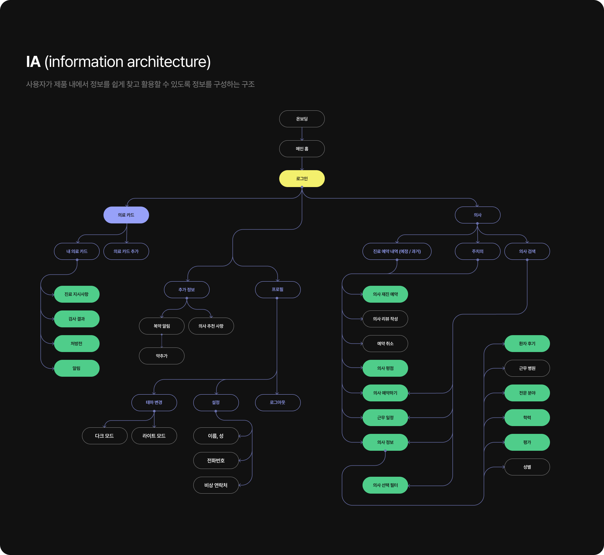
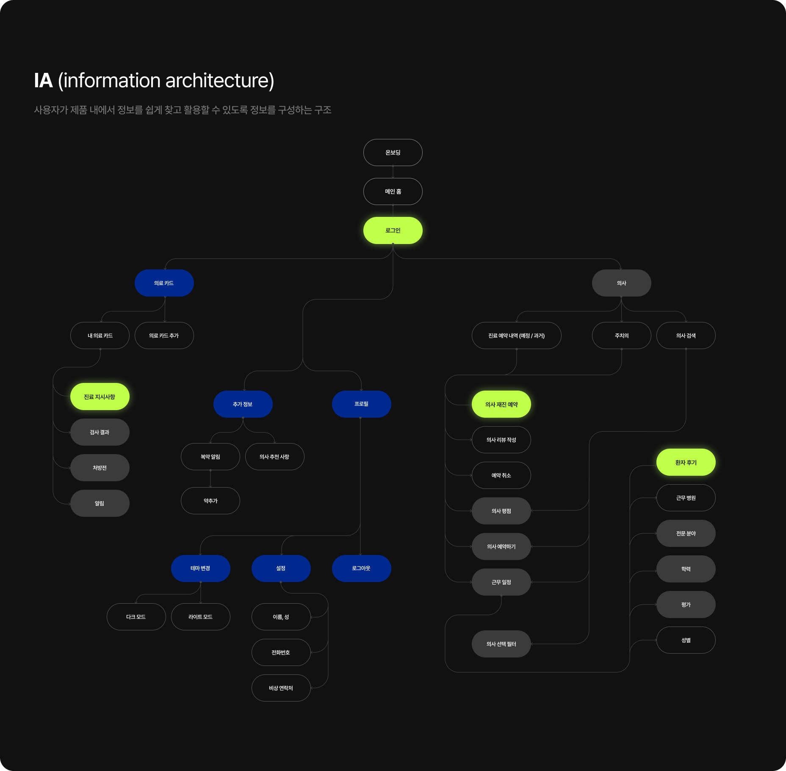
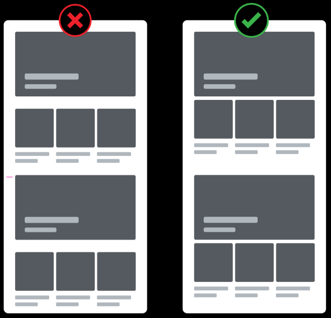
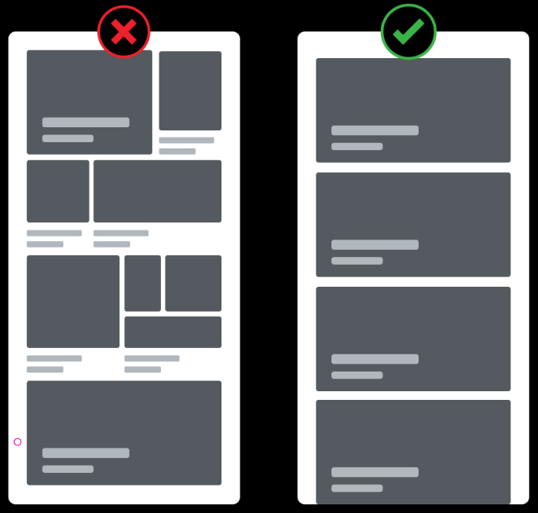
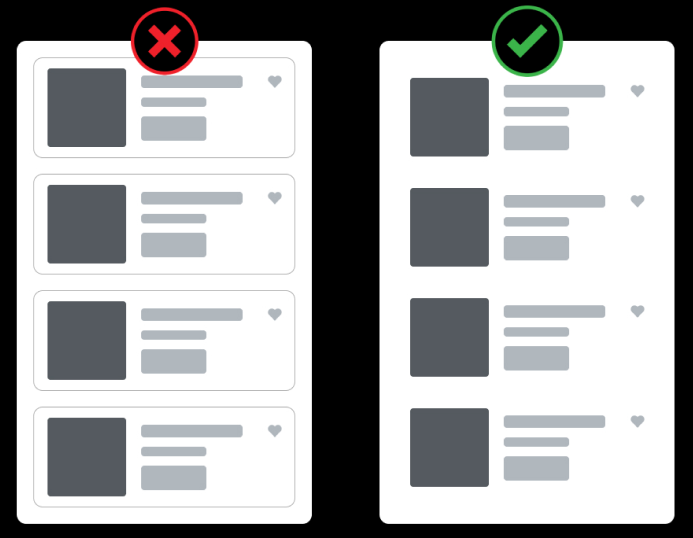

# 4주차 강의

https://www.youtube.com/live/HzDjQpX2n0A

# 본격 디자인 프로세스 단계

디자인을 시작하기 전 사이트의 목적을 이해하고 프로세스를 설계
시각과 사용성 모두 고려

### 리뉴얼이 어려운 이유

이미 기업에서 여러 회의를 거쳐 검증을 끝낸 결과물인데
그 고민을 넘어서려면 단순히 바꾸려고만 하는 것은 부족

UX만 고민 : 기능은 편해졌지만, 서비스의 매력과 브랜드 신뢰도 저하
시각적인 UI만 고민 : 아무도 사용 못하는 사이트

### 약간의 개선은 안하는 게 낫다

리디자인의 핵심은 사용자에게 익숙함을 해치지 않으면서 변화를 주는 것

### 단순 꾸미는 것은 리뉴얼이 아닙니다

디자인은 시각적인 부분도 중요하지만
기존의 문제점, 불편한 점, 매출 증대 효과 등 다양한 방향의 고민이 필요

### 트렌드만 쫓지 마세요

시각적 트렌드도 중요하지만 사용자는 편한 사이트를 좋아한다.
메인에 어떤 요소 및 코너들이 들어가면 좋을지 고민
다만 너무 사용자 위주로 진행하면 기업에서 가져가야 할 핵심 기능 및 코너의 힘이 죽음
적절한 밸런스를 유지하며 구조를 설계하고 절제하여 디자인

### 1. 구축 디자인(사이트 리뉴얼)

전체적으로 사이트를 새롭게 디자인 하는 방향
기존 사이트의 문제점을 개선하고 새롭게 정의하여 스타일 및 컨셉을 적용시켜 디자인

#### 1-1) 주제 선정

리뉴얼 하고자 하는 사이트를 선정, 왜 이 사이트를 결정하게 되었는지,
단순 서비스 기능 개선이 아닌 시각적 디자인까지 포함하여 고민

> 어떤 부분에서 불편한 점을 느꼈고, 실제 다른 사람들도 똑같이 불편했는지,
> 시각적 디자인은 왜 리뉴얼이 필요한지 구체적인 이유

#### 1-2) 사이트 분석

선택한 사이트의 메인에 뿌려져 있는 구성들은 어떤 코너들로 뿌려져 있으며,
이 코너들이 정말 다 필요한 지를 고민

> 개선해야 할 코너들이나 신규로 추가해야 할 코너들은 없는지?
> 과감하게 삭제하거나 다른 곳으로 숨길 필요는 없는지?

#### 1-3) 타 사이트 벤치마킹

경쟁 사이트 및 타 사이트를 벤치마킹하여 문제점의 개선 방향과
시각적인 완성도를 가져갈 수 있는 디자인을 탐색 (직접 사용하면서 찾기)

> 내가 생각했던 방향을 다른 곳에서는 어떻게 사용성과 디자인을 풀어내는지?
> 경쟁 사이트만 벤치마킹하지 말고 다방면으로 사이트를 벤치마킹

#### 1-4) 벤치마킹 구체화

벤치마킹한 여러 사이트 중에서 3~4개 정도로 좁혀 들어가며 점차 방향성 및 생각을 구체화

> 본인이 진행하고자 하는 사이트의 방향과 맞는지 확인
> 디자인과 문제 개선 이 2가지를 동시에 가지고 있는 사이트는 거의 없으며, 각각 따로 탐색
> A 사이트의 UX 참조 + B 사이트의 디자인 방향

#### 1-5) IA

사용자가 정보를 쉽게 찾고 이해하고 이동할 수 있도록
각 페이지별 콘텐츠와 기능 및 구조화시켜 트리구조를 작성

> A정보를 어디에 둬야 하는지 고민
> 가독성 및 사용성을 올리기 위한 메뉴 네이밍 설정
> 사용자가 어떻게 찾을지 트리 구조

#### 1-6) 유저 플로우

전체 경험을 새롭게 정의하고 다시 설계하는 과정
구조, 주요 전환, 세부 흐름을 정의하고 전체 구조를 단순화하여
핵심 전환으로 빠르게 유조하는 방향으로 접근

> 시작점에서 목표까지 도달하도록 설계
> 플로우 및 구조를 재설계
> 사용자의 가설을 바탕으로 실제 사용자 흐름을 이해하며 리뉴얼

#### 1-7) 와이어프레임

레이아웃을 새로 설계한다는 방향으로 기존의 문제점을 파악하고
모든 사항을 반영하여 무에서 유를 만든다는 생각으로 접근

> 전체적인 방향을 보는 과정으로 디테일은 생략하고 덩어리로 접근
> 정보구조, 위계, 사용자 흐름 등 명확하게 전달할 수 있도록 제작

#### 1-8) 목업

벤치마킹한 소스를 바탕으로 디자인하기 전 짜집기를 통해
리뉴얼 방향과 시각적 분위기를 잡아보여 레이아웃 및 컨셉 등을 파악

> 이 화면은 왜 이렇게 배치했을까를 고민하면서 전체적인 구조 다듬기
> 실제 디자인된 것과 같은 디테일로 정확하게 구간을 잘라 짜집기를 집행

#### 1-9) 디자인 방향

리뉴얼 하고자 하는 사이트의 아이덴티티를 녹일 수 있는 스타일과 컨셉을
재정의하며 디자인의 전반적인 방향성을 고민

> 기업의 아이덴티티 분석 및 스타일 적용 방향을 개선
> 네이티브, 하이브리드, 반응형 등 전체적인 유지 보수 등을 고려한 디자인 방향 설계

#### 1-10) 디자인 시스템

정리된 디자인과 구조를 이후에도 일관성 있게 유지하고 확장하기 위한 기준으로
사이트의 일관성과 향후 운영 효율성을 극대화 시키기 위해 작업

> 단순히 이쁘게 정리하는 문서가 아니라 기준과 규칙이 있어야 한다.
> 가이드는 최소한의 케이스로 최대의 효과를 낼 수 있도록 제작

### 2. 서비스 기능 개선

현 사이트의 문제를 보다 편하게 개선해 주는 방향
단순 버튼 위치 조정부터 깊게는 프로세스 단순화 및 신규 서비스 도입 진행

#### 2-1) 문제점 제시

기존 혹은 신규 서비스에서 사용자 경험을 토대로 불편했던 방향을 제시하고 과정을 찾기

> 왜 이 기능을 개선해야 하는가?, 어떤 기능이 문제인가?, 어떤 불편함이 있는가?
> 서비스 기능 개선이 왜 필요한지를 이유와 근거를 바탕으로 고민
> 디자인 리뉴얼이 아니기 때문에 시각적인 고민보다 개선 방향을 깊게 고민

#### 2-2) 가설 설정

문제점을 인지했다면 가설을 세워야 합니다.

> 단계가 깊고 많아서 사용자들이 이탈합니다.
> CTA 버튼이 명확하지 않아 사용자가 인지 하지 못합니다.
> 정보 구조가 복잡하여 가독성이 떨어집니다.

#### 2-3) 타 사이트 벤치마킹

경쟁 사이트 및 타 사이트를 벤치마킹하여 문제점의 개선 방향과
시각적인 완성도를 가져갈 수 있는 디자인을 탐색 (직접 사용하면서 찾기)

> 문제 해결을 위한 직접 사용을 통해 경쟁사를 분석
> 다채로운 사이트 탐색 및 사용

#### 2-4) 벤치마킹 구체화 (생략)

#### 2-5) IA

기능 개선에서 사용자가 쉽게 찾고 뎁스를 줄이며
기존의 문제를 해결하는 트리 구조 작성

> 이 정보가 꼭 지금 여기서 필요한가를 고민
> 뎁스를 줄이기 위한 한 화면으로 합칠 수 없는지 고민
> 숨겨야 할까? 드러내야 할까? 에 대한 항목을 고민

#### 2-6) 유저 플로우

기능 개선에서는 사이트 전체가 아닌 특정 부분의 흐름만 다듬기
혹은 신규 서비스 추가라면 그 서비스에 맞는 흐름을 재구성

> 문제 발생 지점으로부터 그 주변 흐름을 개선
> 기존 구조의 틀을 벗어나지 않는 선에서 부분 최적화 진행
> 사용자의 가설을 바탕으로 실제 사용자 흐름을 이해하고 문제점을 재구성

#### 2-7) 와이어프레임

리뉴얼처럼 구조를 바꾸는 게 아니라 행동을 더 빠르게 만드는 설계
전체 판을 다시 짜는 것이 아닌 문제 구간만 수술하는 접근

> 기존 화면과 신규 와이어 프레임을 동시에 비교할 수 있도록 제작

#### 2-8) 목업

벤치마킹한 소스를 바탕으로 디자인하기 전 짜집기를 통해
서비스 개선 방향과 시각적 분위기를 잡아보며 선 작업을 진행

> 문제점이 실제로 개선되어 보이는지 고민하면서 짜집기를 진행
> 실제 디자인된 것과 같은 디테일로 정확하게 구간을 잘라 짜집기를 집행

#### 2-9) 디자인 방향 (생략)

#### 2-10) 디자인 시스템 (생략)

### 사이트 리뉴얼 / 서비스 기능 개선 공통 단계

#### 11) UXUI 디자인

도출한 정보와 아이디어를 기반으로 디자인을 반복하여
리뉴얼과 사용자 경험을 개선하는 방향으로 진행
이 과정을 지속적인 반복 작업을 통해 사용성과 디자인 목표를 달성할 때 까지 진행

> 시각적 디자인 공통과 시스템을 고려하여 제작
> 일관된 스타일을 유지하며 디자인을 진행
> 문제점을 개선하는 방향으로 진행

#### 12) 프로토타입

완성된 디자인의 프로토타입을 사용하면 사용성을 테스트하고
이해관계자로부터 피드백을 수집하며 개발이 시작되기 전에 디자인을 반복

> 리뉴얼은 중요 핵심 페이지만, 서비스 기능 개선은 변경 부분만 제작
> 프로토타입은 실제와 같이 제작
> 고민했던 모든 로직이 포함되어 있어야 한다

#### 13) QA

설계한 사용자 경험과 디자인이 실제 개발 결과물에 정확히 반영됐는지 확인
기능 오류나 UI 불일치를 수정해 사용자에게 일관되고 안정적인 경험을 제공

> QA는 전문 QA 직업만 참여하는 것은 아니다
> 디자이너도 함께 참여하여 문제점을 찾아낸다

#### 14) AB 테스트

실제 디자인이 나온 화면을 바탕으로 주요 핵심페이지를 중심으로
두 가지 이상의 디자인 또는 기능 안을 실제 사용자에게 노출해,
어떤 안이 더 높은 성과를 내는지 데이터로 검증하기 위해 진행
이를 통해 감이나 추측이 아닌 실제 사용자 반응을 기반으로 더 효과적인 방향을 결정

#### 15) 유저 테스트

실제 사용자가 서비스를 어떻게 이해하고 사용하는지 관찰하여 문제 지점을 발견
이를 통해 디자이너 의도와 실제 사용자 경험 사이의 차이를 확인하고 개선 방향 도출
다양한 사용자 그룹으로 프로토타입 테스트, 사용성 테스트, 사용자 스토리 구체화

#### 16) 배포

디자인이 확정되고 구현된 후 사이트를 공개
디자이너는 지속적으로 사용자 피드백을 모니터하여 사용 데이터를 분석
사이트의 시간이 지나도 효과적이고 긍정적인 반응을 받는지,
오류 사항은 없는지 확인 후 디자인을 계속 업데이트

### IA (information architecture)

사용자가 제품 내에서 정보를 쉽게 찾고 활용할 수 있도록 정보를 구성하는 구조

 

### USER FLOW

가설을 바탕으로 사용자 흐름을 설계

 

## 리뉴얼 프로젝트의 핵심

- 내가 하고싶은 사이트 보다 정말 불편한 혹은 이런 서비스가 있으면 좋겠다라는 명확한 사이트 선택
- 기업의 아이덴티티를 해치지 않는 선에서 리뉴얼이 가능한 사이트 선택
- 편의성과 시각적인 부분을 확실하게 리뉴얼할 수 있는 사이트 선택
- 개발 효율성까지 고민하는 디자이너가 되어야 합니다.

---

# UI를 위한 레이아웃

레이아웃을 이루는 계층 구조는 색, 텍스트, 이미지, 레이어 등의 요소를 배치할 때 중요
컴포넌트 요소들이 결합했을 때 혼란을 줄이고 통일감과 안정감을 준다.

### 1. 접근성

연관성이 있는 요소는 다른 요소들보다 가깝게 배치하는 근접성 원리는
서로 가까운 요소가 관련이 있는 것으로 인식하는 현상으로
여러 요소가 있더라도 서로 가까운 요소를 그룹으로 인식

### 2. 연속성

스크롤되거나 같은 내용이 반복되는 요소를 배치할 때 동일한 모양을 특정 선에 맞춰 정렬
요소들의 배치에서 방향성을 인지할 때 해당 방향의 요소들을 그룹으로 인지
시선의 흐름에 따라 직선 또는 곡선으로 배치된 요소들을 그룹으로 인지

### 3. 폐쇄성

가급적 여백과 간격으로 전체 모양을 디자인
각 요소들이 선으로 연결되지 않았더라도 눈의 흐름을 따라 전체의 모양을 파악
선이나 네모 요소의 그룹핑보다 여백과 간격으로 전체 모양을 만들어 인지 부하를 줄인다.

---

# 디자인 벤치마킹

다른 서비스나 제품의 성공적인 디자인 사례를 분석하고 연구
자신의 디자인 프로젝트에 적용할 아디디어나 영감을 얻는 과정
단순히 디자인 요소를 모방하는 것을 넘어,
사용자 경험과 인터페이스 디자인의 원리를 분석하고 적용하는 전략적 활동

### 벤치마킹은 왜 해야 할까?

보통 새로운 사이트를 구축하거나 자사 서비스 개선, 포트폴리오 등
이벤트가 발생하는 경우 초기 집입 단계에서 진행

- 1. 사용자 경험 향상
     : 다양한 서비스의 사용자 경험을 분석하고, 만족할 만한 디자인 요소를 파악
     : 서비스에 적용하여 차별화된 디자인 전략을 수립하고 경쟁 우위를 확보

- 2. 새로운 아이디어 창출
     : 기존의 문제점을 파악하고 개선하여, 사용성이 높은 구조와 설계를 만들고
     : 다양한 사례를 통해 새로운 아이디어를 얻고, 개발하는 데 영감을 얻는다.

- 3. 트렌드 파악
     : 최신 디자인 트렌드를 파악하고, 우리의 디자인의 컨셉 및 스타일을 정의하여
     : 기존 디자인을 참고하되, 너무 해치지 않는 방향으로 벤치마킹

### 잘못된 벤치마킹

- 1. 유사한 서비스만 찾아 리스트업 하는 경우
- 2. 편하다는 관점으로 본인에게만 적용하는 경우
- 3. 자사 서비스와 기능으로만 고민하는 경우

### 막막한 벤치마킹

벤치마킹의 목적은 여러 사이트를 조사하여 어떤 쪽으로 방향을 잡아야 할 지 결정
결정을 위해서는 기준을 하나로 잡고 결과를 추출해야 비교가 가능하여 선택할 수 있다.

### 1. 목적을 찾아보자

디자인 하고자 하는 사이트의 현재 위치를 파악하고
잘하는 것, 못하는 것을 나누고 구성하여 리뉴얼 하는 목적의 기준을 잡는다.

### 2. 후보군을 나열한다

커머스의 경우 리뉴얼 하고자 하는 사이트와 비슷한 앱을 찾아 자료를 스크랩
자료가 없다는 카테고리 군에 현혹되는 것 보단 큰 틀이 커머스라는 것을 명심

> 음식 관련 앱을 리뉴얼하는 경우 음식 관련을 주로 찾는 건 맞지만
> 패션, 네이버 쇼핑 등 타 카테고리 군에서도 아이디어를 가져올 수 있다.

### 3. 정리하다

벤치마킹으로 관련 앱을 스크랩 했다면 대체로 메인을 기준으로
어떤 구성과 어떤 흐름으로 코너들이 구성 되었는지 감이 오기 시작한다.

### 4. 벤치마킹 시작

벤치마킹 사이트의 특징을 채용해 우리 디자인에 어떻게 표현할 수 있는 지 고민

## 목적의 기준이 없으면 안됩니다.

- 새로운 것을 창작하는 것은 UI 디자인에서 위험 부담이 너무 크다
- 좋은 예술가는 따라 하는데 그치지만, 훌륭한 예술가는 훔쳐버린다.
- 구조가 만들어져야 시각이 존재한다.
- 무작정 좋은 기능을 마구잡이로 넣는 것보다 멍청한 짓은 없다.
- 내가 어떤 사이트를 만들지 명확하게 인지해라.
