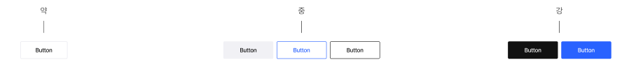

# 6주차 강의

https://www.youtube.com/live/RZzNiRs4UxA

# 누르는 행위를 유발한다

버튼을 이해하면 UI 디자인의 70%를 이해한 것과 같고
사용자의 패턴을 읽을 수 있게 된다.

### 엄지 존을 위한 배치

한 손 유저를 고려한 버튼 위치 설계가 필요
상단은 터치하기가 어렵고, 하단으로 갈수록 비교적 편해진다.

### 중요한 버튼은, 중요한 위치에

타 사이트 벤치마킹을 통해 핵심 버튼들의 위치를 파악
1번 클릭하면 재클릭할 확률이 드문 버튼의 위치를 파악

### 계층구조

버튼은 계층구조에 따라 강약을 다르게 사용

### 버튼 스타일

- 버튼의 종류는 크게 총 4가지로 정의
- 좌우 마진은 버튼의 최소값과 텍스트가 어디까지 작성될 지의 마진
- 기본 버튼형 : BG 강조(블랙, 브랜드)/비강조, Line 강조(블랙, 브랜드)/비강조, 아이콘 포함, 로딩, 아이콘, 더보기
- 텍스트 버튼형 : 언더라인, 정보, 화살표, 아이콘
- 바텀 하단 버튼형 : 1단, 2단, 3단, 4단

### 버튼과 컨텐츠의 구분

버튼에 사용한 색상을 콘텐츠에 사용하면
사용자는 무의식적으로 혼란스러워 한다.

### 버튼은 곧 전환율이다

사용자가 버튼을 누르지 않는다면 아무일도 일어나지 않는다.

### 버튼과 아이콘의 의미

버튼에는 아이콘이 있는 경우와 없는 경우가 있다.
강조를 하기 위한 아이콘이 있을 수 있지만
화살표만은 그 의미를 명확하게 이해하고 사용해야 한다.
(화살표는 다른 페이지로 이동한다는 의미)

### 어떤게 맞을까?

사용자가 인지하기 좋은 버튼은
왼쪽 취소버튼, 오른쪽 확인버튼(클릭을 유도하는 버튼)

### 버튼 상태값

- 버튼의 상태값은 총 6가지로 정의 (디자인 상황에 따라 4개 요약)
- 각 버튼의 형태에 따라 상태 값이 상이
- Default, Hover, Focus, Press, Disabled, Progress, Only Icons

### 버튼 간의 간격

- 경우에 따라 각 버튼은 간격 없이 붙여서 사용
- Tiny 28 버튼은 갭 6px이고, 나머지는 8px로 통일

### 버튼 제작 가이드

- 기본버튼 형태의 높이 값은 총 5가지로 정의
- 버튼에 입력되는 폰트는 모두 Pretendard로 통일

- 1. X Large 54
     : 특별한 경우에만 사용하는 가장 큰 버튼 사이즈
     : min-width: 87, height 54, padding 0 16 (둥근버튼 0 20),
     : Pretendar / f-w SemiBold / f-s 16 / l-s -2.5% / l-h 140%
- 2. Large 48
     : 가장 많이 사용되는 버튼 큰 사이즈
     : min-width: 80, height 48, padding 0 16 (둥근버튼 0 20),
     : Pretendar / f-w SemiBold / f-s 14 / l-s -2.5% / l-h 145%
- 3. Medium 42
     : 가장 많이 사용되는 버튼 중 사이즈
     : min-width: 72, height 42, padding 0 12 (둥근버튼 0 16),
     : Pretendar / f-w Medium / f-s 14 / l-s -2.5% / l-h 145%
- 4. Small 36
     : 가장 많이 사용되는 일반 버튼 사이즈
     : min-width: 68, height 36, padding 0 12 (둥근버튼 0 12),
     : Pretendar / f-w Medium / f-s 13 / l-s -2.5% / l-h 145%
- 5. X Small 32
     : 가장 많이 사용되는 일반 버튼 사이즈
     : min-width: 68, height 32, padding 0 12 (둥근버튼 0 12),
     : Pretendar / f-w Medium / f-s 13 / l-s -2.5% / l-h 145%
- 6. Tiny 28
     : 특별한 경우에만 사용하는 가장 작은 버튼 사이즈
     : min-width: 61, height 28, padding 0 10 (둥근버튼 0 10),
     : Pretendar / f-w Medium / f-s 12 / l-s -2.5% / l-h 145%

### 텍스트 버튼

- 텍스트형 버튼은 총 4가지 스타일로 정의
- 각 스타일 마다 텍스트 버튼은 3가지 사이즈로 정의

- 1. 언더라인 (text-decoration)
     : f-w Medium / f-s 14
     : f-w Medium / f-s 13
     : f-w Medium / f-s 12
- 2. 정보 (텍스트 오른쪽에 정보 아이콘)
     : f-w Medium / f-s 14 / gap 4 / 아이콘 20x20
     : f-w Medium / f-s 13 / gap 4 / 아이콘 20x20
     : f-w Medium / f-s 12 / gap 4 / 아이콘 16x16
- 3. 화살표 (텍스트 양옆에 화살표 아이콘)
     : f-w Medium / f-s 14 / gap 2 / 아이콘 20x20
     : f-w Medium / f-s 13 / gap 2 / 아이콘 20x20
     : f-w Medium / f-s 12 / gap 2 / 아이콘 16x16
- 4. 아이콘 (텍스트 양옆에 아이콘)
     : f-w Medium / f-s 14 / gap 4 / 아이콘 20x20
     : f-w Medium / f-s 13 / gap 4 / 아이콘 20x20
     : f-w Medium / f-s 12 / gap 4 / 아이콘 16x16

### 아이콘 버튼

- 아이콘은 좌/우 모두 삽입하는 가이드
- 일반 아이콘과 화살표는 구분하여 따로 정의

- 1. X Large 54
     : 일반 아이콘 gap 4 / 아이콘 20x20
     : 화살표 아이콘 gap 6 / 아이콘 16x16
- 2. Large 48
     : 일반 아이콘 gap 4 / 아이콘 20x20
     : 화살표 아이콘 gap 6 / 아이콘 16x16
- 3. Medium 42
     : 일반 아이콘 gap 4 / 아이콘 16x16
     : 화살표 아이콘 gap 4 / 아이콘 12x12
- 4. Small 36
     : 일반 아이콘 gap 4 / 아이콘 16x16
     : 화살표 아이콘 gap 4 / 아이콘 12x12
- 5. X Small 32
     : 일반 아이콘 gap 4 / 아이콘 16x16

### 바텀 버튼

- 좌우 마진은 디자인 해상도 마진을 따라간다.
- 디자인 해상도 좌우 마진은 최대 20으로 고정

- 1. 1단
     : 상하 margin 12
- 2. 2단
     : 상하 margin 12 / gap 8
- 2. 3단
     : 상하 margin 12 / gap 8
- 2. 4단
     : 상하 margin 12 / 가로 gap 8 / 세로 gap 8
